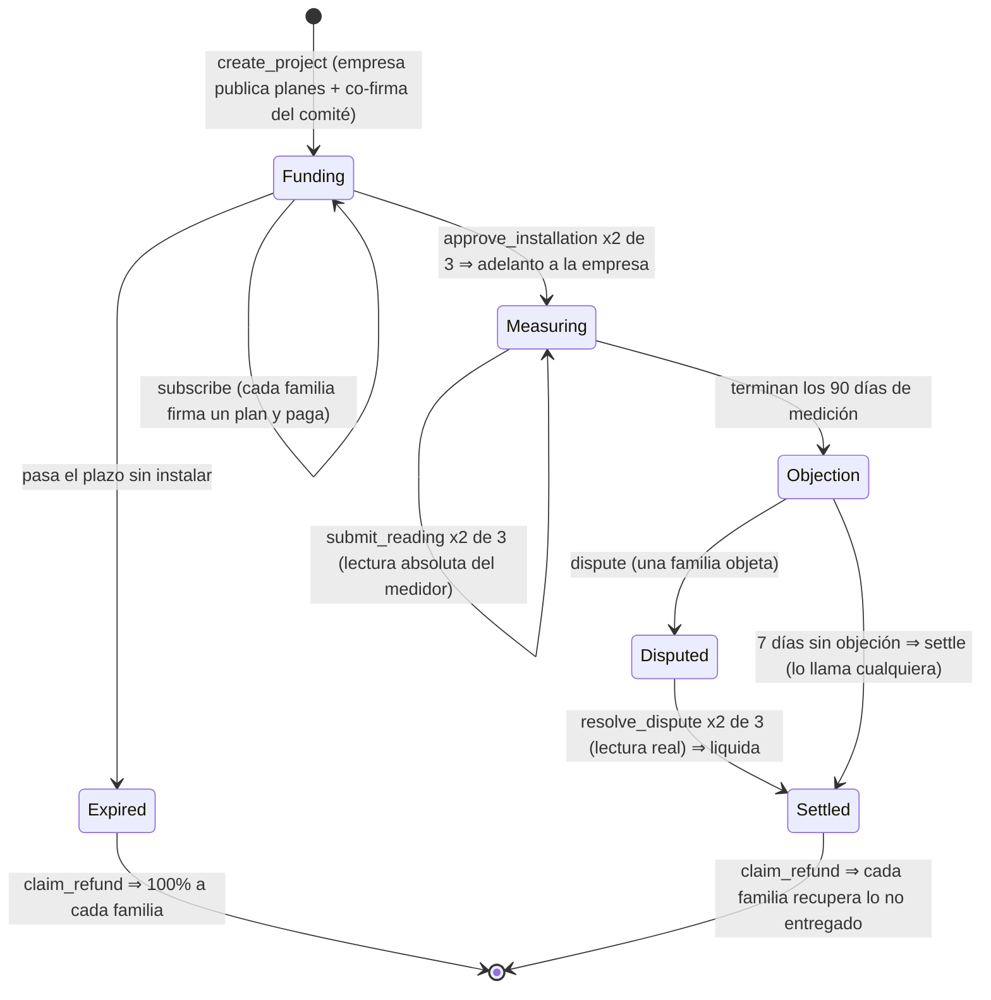

# ☀️ Sol Comunitario

**Energía solar por suscripción para comunidades de Costa Rica, pagada por la energía que realmente llega.**
Un contrato inteligente en **Stellar (Soroban)** hecho para el reto de la semana 2 del *Pura Vida Bootcamp* (Oppia Climb).

🌞 **Página + simulador:** https://relichtyy.github.io/sol-comunitario/
⛓️ **Contrato en vivo (testnet):** [`CCYWNAGKTLO7Y5M57EYGUJK35AVWPCVBMSX4GAEOEFFO66QILGISZKNM`](https://stellar.expert/explorer/testnet/contract/CCYWNAGKTLO7Y5M57EYGUJK35AVWPCVBMSX4GAEOEFFO66QILGISZKNM)

---

## 1. El problema (en una frase)

> Una empresa ofrece paneles solares a las familias de un pueblo, pero las familias tienen que **pagar por adelantado y confiar** en que la energía prometida va a llegar.

### La historia

**Sol Comunitario S.A.** llega a Santa Teresa con planes de energía solar: *Básico* (1 panel), *Familiar* (2) y *Comercio* (4). A cada familia le muestra **cuánto ahorraría** en su recibo de luz. Doña Ana (soda), Beto (pulpería) y la familia Mora quieren firmar. Pero:

- 💸 **Pagan antes de ver un solo kWh.** Si los paneles rinden la mitad, la plata ya se fue.
- 🤷 **¿Quién mide?** Si la empresa reporta su propia energía, ¿quién le cree?
- 🧾 **¿Y si nunca instalan?** Recuperar la plata es un pleito.

### Por qué lo elegí

La generación solar distribuida está creciendo en Costa Rica, pero contratarla sigue siendo un acto de fe. Un contrato inteligente resuelve justo esa parte: **guarda la plata de forma neutral, paga solo por resultados y devuelve lo que no se cumplió**. Es un problema pequeño y concreto: una empresa, unos planes, unas cuantas familias y un comité de vecinos.

---

## 2. La solución

El dinero **no lo guarda la empresa**: lo guarda el contrato. La empresa cobra **en proporción a la energía entregada**, y la comunidad, no la empresa, verifica las lecturas.



### Los actores

| Actor | Qué hace |
|---|---|
| 🏢 **Sol Comunitario S.A.** (la empresa) | Publica los planes, instala los paneles y cobra según la energía entregada. |
| 🏡 **Familias** | Eligen un plan, firman y pagan. Reciben su parte de la energía y del ahorro. |
| 👥 **Comité de vecinos** (ADI/ASADA, 3 miembros, 2 firmas) | Confirma la instalación y firma las lecturas del medidor. La empresa **no** reporta su propia energía. |

### Las fórmulas

```
promesa del proyecto = suma de los kWh de los planes firmados
ganado por la empresa = total × min(generado, prometido) / prometido
pago final            = max(ganado − adelanto, 0)
energía de la familia = generado × (kWh de su plan / promesa del proyecto)
reembolso             = lo que pagó × (total − pagado a la empresa) / total
ahorro estimado       = kWh × tarifa eléctrica   ← off-chain, la tarifa cambia
```

**Ejemplo (el del simulador):** Ana firma *Familiar* (500 kWh), Beto *Comercio* (1 000 kWh) y los Mora *Familiar* (500 kWh). La promesa es 2 000 kWh. Los paneles generan 1 600 kWh (80%):

| | Recibe | De vuelta |
|---|---|---|
| Empresa | 80% de lo firmado | — |
| Doña Ana | 400 kWh | 20% de lo que pagó |
| Beto | 800 kWh | 20% de lo que pagó |
| Familia Mora | 400 kWh | 20% de lo que pagó |

### Protecciones del contrato

- 🔐 **Comité con mayoría (2 de 3):** ninguna persona sola confirma la instalación ni firma lecturas.
- 📈 **Lecturas absolutas del medidor:** el medidor solo sube. Reportar dos veces el mismo mes o un número menor se rechaza (`MeterNotIncreasing`).
- 🗳️ **Si las lecturas no coinciden, no cuentan** hasta que la mayoría firme el mismo valor.
- 🙋 **7 días de objeción:** cualquier familia que firmó puede objetar (`dispute`). El proyecto se congela hasta que el comité firme la lectura real (`resolve_dispute`).
- ⏰ **Plazos:** sin instalación a tiempo, 100% de vuelta. `settle` lo puede llamar **cualquiera**, así nadie bloquea la plata quedándose quieto.
- 🧮 **Topes:** el adelanto es como máximo 50% y el pago como máximo 100%, aunque se genere de más.
- 🚫 **Sin dobles:** una familia firma un solo plan por proyecto y no puede reclamar dos veces.

---

## 3. Funciones del contrato

| Función | Quién firma | Qué hace |
|---|---|---|
| `initialize(committee, threshold, token)` | Todo el comité | Configura las credenciales (cuenta + rol), cuántas firmas se necesitan y el token (USDC, XLM…). |
| `create_project(installer, member, name, plans, advance_bps, install_days, measure_days)` | Empresa + un miembro | Publica de 1 a 5 planes `{name, panels, price, kwh}`. Devuelve el `id`. |
| `subscribe(neighbor, id, plan)` | Familia | Firma un plan: paga su precio y la promesa del proyecto crece con sus kWh. |
| `approve_installation(member, id, meter_start)` | Miembro del comité | Firma la instalación. Con mayoría paga el adelanto y empieza a medir. |
| `submit_reading(member, id, meter)` | Miembro del comité | Firma una lectura absoluta. Con mayoría actualiza los kWh generados. |
| `dispute(neighbor, id)` | Familia que firmó | En los 7 días de objeción, congela el proyecto. |
| `resolve_dispute(member, id, meter)` | Miembro del comité | Firma la lectura real. Con mayoría corrige y liquida en el acto. |
| `settle(id)` | Cualquiera | Sin objeciones, paga a la empresa lo que ganó. |
| `claim_refund(neighbor, id)` | Familia | Recupera su parte de lo no entregado (o el 100% si nunca se instaló). |
| `rotate_member(member, old, new)` | Miembro del comité | Cambio de llave (ej. celular perdido); la nueva hereda el rol. 2 de 3. |
| `revoke_member(member, target)` | Miembro del comité | Saca a alguien del comité sin romper el umbral. 2 de 3. |
| `get_project`, `get_plans`, `get_share`, `get_contribution`, `get_config`, `is_member`, `project_count`, `performance_bps` | — | Consultas. `get_share` dice cuántos kWh le tocan a cada familia. |

---

## 4. Identidad del comité (estilo DID) y estándares

### Qué va on-chain y qué no

**Regla:** en la cadena solo va lo que el contrato necesita para decidir quién puede mover la plata. Todo lo demás va afuera.

| ⛓️ On-chain (en el contrato) | 📄 Off-chain (fuera de la cadena) |
|---|---|
| La cuenta G/C de cada miembro del comité, su rol y desde cuándo está vigente | Su DID `did:pkh:stellar:testnet:G…`, que **se calcula** a partir de la cuenta |
| Los planes (precio, paneles, kWh) y qué plan firmó cada familia | Nombres, cédulas y teléfonos. **Nunca on-chain:** la cadena es pública y permanente (Ley 8968 de protección de datos) |
| Pagos, firmas del comité, lecturas, disputas y reembolsos | La tarifa eléctrica y el **ahorro estimado** en colones (cambian con el tiempo) |
| Rotar y revocar miembros (2 de 3) | El `stellar.toml` de la ADI (SEP-1), fotos de la instalación y del medidor |
| Eventos de auditoría (`firma`, `lectura`, `disputa`, `rotar`…) | El login (SEP-10/45), los QR para firmar (SEP-7) y la página web |

**¿Por qué "estilo DID"?** Un DID separa **quién sos** (identidad y rol) de **con qué llave firmás**. Si Luis pierde el celular, Marta y Sofía firman `rotate_member` y su llave nueva hereda el rol "Fontanero ASADA". El comité nunca queda con una llave muerta.

### Cuentas G y C

| Prefijo | Qué es |
|---|---|
| `G…` | Cuenta clásica de Stellar (llave pública ed25519). Es la de Freighter, Lobstr, etc. |
| `C…` | Un contrato. También puede ser una *smart wallet*, por ejemplo con passkey (huella o Face ID). |

El contrato usa `Address` y `require_auth()`, que **aceptan los dos tipos**. Una familia puede firmar con su wallet normal (G) o con la huella del celular (C) sin cambiar el contrato.

### SEPs (Stellar Ecosystem Proposals)

| SEP | Qué es | En Sol Comunitario |
|---|---|---|
| **SEP-41** | Interfaz estándar de tokens | ✅ Los pagos usan `token::Client`: funciona con USDC, XLM o cualquier token SEP-41. En testnet usa XLM. |
| **SEP-46** | Metadatos del contrato | ✅ `contractmeta!`: nombre, versión, descripción y repo, grabados en el WASM. |
| **SEP-48** | Especificación de la interfaz | ✅ La genera el SDK; la usan `stellar contract bindings` y los exploradores. |
| SEP-1 | `stellar.toml` | La ADI publica sus cuentas en su dominio (off-chain). |
| SEP-10 / SEP-45 | Login web con cuenta G / C | Para un frontend real (off-chain). |
| SEP-7 | URI `web+stellar:` | QR en el salón comunal para firmar desde el celular. |
| SEP-53 | Firmar mensajes | Siguiente paso: que el medidor firme sus propias lecturas. |

### Equivalencia con los roles de Trustless Work

| Trustless Work | Sol Comunitario |
|---|---|
| Service provider / receiver | La empresa Sol Comunitario |
| Approver + release signer | Comité 2 de 3 (`approve_installation`, `submit_reading`) |
| Dispute resolver | Comité 2 de 3 (`resolve_dispute`) |
| Milestones | Instalación → lecturas mensuales → liquidación |

---

## 5. ¿Cómo sé que el contrato es real? (testnet)

El contrato está desplegado en **Stellar testnet** con una demo cargada: comité de 3, los 3 planes, dos familias suscritas, instalación confirmada y la primera lectura (180 de 750 kWh).

- 🔎 **Explorador:** [stellar.expert · contrato](https://stellar.expert/explorer/testnet/contract/CCYWNAGKTLO7Y5M57EYGUJK35AVWPCVBMSX4GAEOEFFO66QILGISZKNM). Ahí se ven todas las transacciones.
- 🌞 **La página** tiene una sección *"El contrato real, en vivo"* que lee `get_project`, `get_config` y `get_plans` directo de la red.
- 🖥️ **Desde la terminal:**

```bash
stellar contract invoke --id CCYWNAGKTLO7Y5M57EYGUJK35AVWPCVBMSX4GAEOEFFO66QILGISZKNM \
  --source <cualquier-identidad> --network testnet --send=no -- get_project --id 0
```

---

## 6. Cómo correrlo

### Requisitos
- [Rust](https://rustup.rs/) y [Stellar CLI](https://developers.stellar.org/docs/tools/cli)
- Node.js 20+ (solo para el script de demo)

### Pruebas

```bash
cargo test
```

> 💡 **En Windows sin Visual Studio C++**, usá el toolchain GNU, que trae su propio linker:
> `rustup toolchain install stable-x86_64-pc-windows-gnu` y luego `cargo +stable-x86_64-pc-windows-gnu test`

### Desplegar tu propia copia en testnet

```bash
rustup target add wasm32v1-none
stellar contract build

# identidades de demo (con XLM de testnet)
for k in sc-deployer sc-marta sc-luis sc-sofia sc-ana sc-beto sc-solartico; do
  stellar keys generate $k --network testnet --fund
done

stellar contract deploy --wasm target/wasm32v1-none/release/sol_comunitario.wasm \
  --source sc-deployer --network testnet
```

### Cargar la demo

`initialize` y `create_project` necesitan **varias firmas** (todo el comité, empresa + miembro), algo que el CLI no arma solo. El script [`scripts/demo-testnet.mjs`](scripts/demo-testnet.mjs) usa `@stellar/stellar-sdk` para juntar esas firmas (`authorizeEntry`) y deja la demo cargada:

```bash
cd scripts && npm install
node demo-testnet.mjs <CONTRACT_ID>        # paso opcional: <CONTRACT_ID> 2 para retomar
```

Las llaves se leen del Stellar CLI local (`stellar keys show`) y **nunca** se guardan en el repo.

---

## 7. Pruebas (27 en total, todas ✅)

Las pruebas están en [`contracts/sol-comunitario/src/test.rs`](contracts/sol-comunitario/src/test.rs) y se escribieron **antes** del código (TDD).

| Grupo | Pruebas | Qué demuestran |
|---|---|---|
| Camino feliz | `camino_feliz_80_por_ciento_de_la_energia` | Planes, firmas, adelanto, 3 lecturas, energía por familia (400/200 kWh), liquidación y reembolsos. |
| Planes | `familias_firman_un_plan_y_la_promesa_crece` | La promesa crece con cada plan; no se firma dos veces ni un plan inexistente. |
| Comité 2 de 3 | `una_sola_firma_no_libera_el_adelanto`, `nadie_firma_dos_veces`, `extranos_no_pueden_firmar`, `lecturas_en_desacuerdo_no_cuentan_hasta_tener_mayoria`, `el_medidor_nunca_retrocede` | Nadie decide solo; las lecturas solo suben y necesitan mayoría. |
| Pago por resultado | `sobre_generar_no_paga_mas_del_100`, `paneles_que_no_generan_empresa_solo_se_queda_el_adelanto`, `nunca_se_instala_familias_recuperan_todo` | Tope del 100%, bajo rendimiento y reembolso total. |
| Tiempos y estados | `no_se_liquida_antes_de_tiempo_ni_se_mide_despues`, `no_doble_liquidacion_ni_doble_reembolso`, `no_se_instala_sin_familias_ni_se_firma_despues_de_instalar`, `lecturas_solo_durante_la_medicion` | Cada función solo en su momento. |
| Validaciones | `validaciones_de_creacion`, `comite_invalido_y_doble_inicializacion`, `crear_proyecto_requiere_firma_de_empresa_y_miembro`, `redondeo_nunca_deja_al_contrato_en_negativo` | Planes inválidos, adelanto > 50%, comité mal formado, firmas requeridas y redondeo seguro. |
| Objeción | `no_se_liquida_durante_la_objecion`, `familia_objeta_y_el_comite_corrige_la_lectura`, `solo_quien_firmo_un_plan_puede_objetar`, `objecion_solo_dentro_del_plazo`, `resolver_requiere_disputa_abierta_y_comite` | Lectura inflada (1 000 kWh) corregida a la real (600) antes de pagar. |
| Identidad | `las_credenciales_guardan_rol_y_fecha`, `luis_pierde_el_celular_y_rota_su_llave`, `rotar_valida_miembros`, `revocar_miembro_con_mayoria_sin_romper_el_umbral` | Credenciales con rol, rotación de llave y revocación por mayoría. |

```
test result: ok. 27 passed; 0 failed
```

---

## 8. La página

**https://relichtyy.github.io/sol-comunitario/** tiene dos partes:

1. **Simulador guiado (6 pasos)** con las mismas reglas del contrato: la empresa publica planes con su ahorro estimado, las familias eligen y firman (las monedas vuelan a la bóveda), el comité firma 2 de 3, 3 meses de lecturas, objeción y liquidación con la energía, el ahorro y el reembolso de cada familia. Incluye 4 escenarios: rinde 80%, rinde 15%, lecturas infladas y nunca se instala.
2. **El contrato real, en vivo:** lee el estado del contrato desplegado en testnet.

Está hecha con componentes de [ui-sdk](https://ui-sdk.dev) (tabs, slider, switch, dialog y tooltip) y respeta `prefers-reduced-motion`.

---

## 9. Qué sigue

- Que el **medidor firme sus propias lecturas** (SEP-53) y el comité solo co-firme.
- Pagos en **USDC** o una stablecoin en colones en vez de XLM.
- Conectar la página a **Freighter** para que las familias firmen desde el navegador.
- Un fondo de mantenimiento opcional para limpiar los paneles.

---

Hecho con ☀️ en Costa Rica por **Rihito** — *Pura Vida Bootcamp, semana 2 · 3 000 m*
