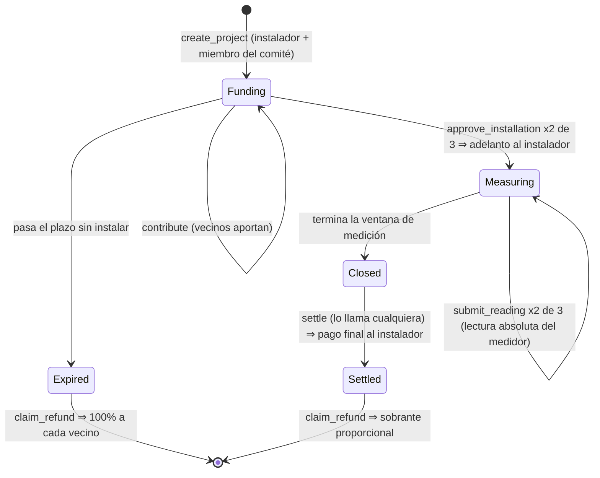

# ☀️ Sol Comunitario

**Paneles solares para la comunidad, pagados por la energía que realmente generan.**
Un contrato inteligente en **Stellar (Soroban)** hecho para el reto de la semana 2 del *Pura Vida Bootcamp* (Oppia Climb).

🔗 **Simulador interactivo:** [`docs/index.html`](docs/index.html) (publicado en GitHub Pages)

---

## 1. El problema (en una frase)

> En un pueblo de Costa Rica, los vecinos juntan plata para poner paneles solares en el salón comunal, **pero no tienen forma de asegurarse de que el instalador cumpla lo que prometió.**

### La historia

En Santa Teresa, en Pital o en cualquier comunidad rural, el salón comunal, la escuela o la bomba de la ASADA pagan recibos de luz altos. Los vecinos hacen rifas y turnos para juntar ₡3 000 000 y contratar a un instalador de paneles.

El instalador promete *"estos paneles van a generar 1 000 kWh en 3 meses"*. Pero:

- 💸 **Se paga todo por adelantado.** Si los paneles rinden la mitad, la plata ya se fue.
- 🤷 **Nadie mide.** No hay un registro claro y compartido de cuánto generan.
- 🧾 **Desconfianza.** ¿Quién guarda la plata? ¿El tesorero? ¿Y si se la gasta?

### Por qué lo elegí

Costa Rica ya tiene la mayor parte de su electricidad de fuentes renovables, y la generación distribuida (paneles en techos) está creciendo. Pero **los proyectos comunitarios todavía se manejan con confianza y cuadernos**. Un contrato inteligente resuelve justo la parte difícil: **guardar la plata de forma neutral y pagar solo por resultados.** Además es un problema pequeño y concreto: un proyecto, un instalador, unos cuantos vecinos.

---

## 2. La solución

El dinero **no lo guarda nadie**: lo guarda el contrato. Y se paga **en proporción a la energía generada**.



### Los actores

| Actor | Qué hace |
|---|---|
| 🧑‍🔧 **Instalador** | Propone el proyecto, instala los paneles y cobra según los resultados. |
| 👥 **Comité de vecinos** (ej. 3 miembros, se necesitan 2 firmas) | Confirma la instalación y firma las lecturas del medidor. Ninguna persona sola puede mover la plata. |
| 🏡 **Vecinos** | Aportan dinero y recuperan lo que el instalador no se ganó. |

### La fórmula (lo más importante)

```
ganado       = total × min(kWh generados, kWh prometidos) / kWh prometidos
pago final   = max(ganado − adelanto, 0)
reembolso    = aporte del vecino × (total − pagado al instalador) / total
```

**Ejemplo:** se juntan ₡10 000, se prometen 1 000 kWh y hay un 30% de adelanto.

| Paneles generan | Instalador recibe | Vuelve a los vecinos |
|---|---|---|
| 1 200 kWh (120%) | ₡10 000 (tope del 100%) | ₡0 |
| 800 kWh (80%) | ₡3 000 adelanto + ₡5 000 = **₡8 000** | **₡2 000** |
| 100 kWh (10%) | ₡3 000 (solo el adelanto) | ₡7 000 |
| Nunca se instala | ₡0 | **₡10 000 (100%)** |

### Protecciones que tiene el contrato

- 🔐 **Comité con mayoría (2 de 3):** el instalador no puede ponerse de acuerdo con un solo vecino para inflar los números.
- 📈 **Lecturas absolutas del medidor:** se reporta lo que marca el medidor, que solo puede subir. Si se reporta dos veces el mismo mes o se escribe un número menor, el contrato lo rechaza (`MeterNotIncreasing`).
- 🗳️ **Si las lecturas no coinciden, no cuentan:** si un miembro dice 300 y otro dice 250, no se aplica ninguna hasta que la mayoría firme el mismo valor.
- ⏰ **Plazos:** si no se instala a tiempo, todos recuperan el 100%. La liquidación (`settle`) la puede llamar **cualquiera**, así nadie bloquea los fondos dejando de actuar.
- 🧮 **Tope de adelanto del 50%** y **tope de pago del 100%** aunque los paneles generen de más.
- 🚫 **Sin doble cobro:** el aporte se borra antes de transferir el reembolso.

---

## 3. Funciones del contrato

| Función | Quién firma | Qué hace |
|---|---|---|
| `initialize(committee, threshold, token)` | Todo el comité | Configura los miembros, cuántas firmas se necesitan y el token (USDC o XLM). |
| `create_project(installer, member, name, kwh_promised, advance_bps, install_days, measure_days)` | Instalador + un miembro | Crea el acuerdo. Devuelve el `id`. |
| `contribute(neighbor, id, amount)` | Vecino | Aporta fondos, que quedan bloqueados en el contrato. |
| `approve_installation(member, id, meter_start)` | Miembro del comité | Firma la instalación. Con la mayoría paga el adelanto y empieza a medir. |
| `submit_reading(member, id, meter)` | Miembro del comité | Firma una lectura absoluta. Con la mayoría actualiza los kWh generados. |
| `settle(id)` | Cualquiera | Al terminar la ventana, paga al instalador lo que ganó. |
| `claim_refund(neighbor, id)` | Vecino | Recupera su parte del sobrante (o el 100% si nunca se instaló). |
| `get_project`, `get_contribution`, `get_config`, `project_count`, `performance_bps` | — | Consultas. |

---

## 4. Cómo correrlo

### Requisitos
- [Rust](https://rustup.rs/)
- (Para desplegar) [Stellar CLI](https://developers.stellar.org/docs/tools/cli)

### Pruebas

```bash
cargo test
```

> 💡 **En Windows sin Visual Studio C++**, usá el toolchain GNU, que trae su propio linker:
> `rustup toolchain install stable-x86_64-pc-windows-gnu` y luego `cargo +stable-x86_64-pc-windows-gnu test`

### Compilar a WASM y desplegar en testnet

```bash
rustup target add wasm32v1-none
stellar contract build

stellar keys generate --global comite1 --network testnet --fund
stellar contract deploy \
  --wasm target/wasm32v1-none/release/sol_comunitario.wasm \
  --source comite1 --network testnet
```

Luego se invoca, por ejemplo:

```bash
stellar contract invoke --id <CONTRACT_ID> --source comite1 --network testnet -- \
  submit_reading --member <DIRECCION_COMITE1> --id 0 --meter 5250
```

---

## 5. Pruebas (17 en total, todas ✅)

Las pruebas están en [`contracts/sol-comunitario/src/test.rs`](contracts/sol-comunitario/src/test.rs) y se escribieron **antes** del código (TDD).

| Prueba | Qué demuestra |
|---|---|
| `camino_feliz_80_por_ciento_de_la_energia` | El flujo completo: aportes, adelanto, 3 lecturas mensuales, liquidación y reembolsos (₡8 000 / ₡1 500 / ₡500). |
| `una_sola_firma_no_libera_el_adelanto` | Una sola firma no mueve la plata; con 2 de 3 sí. |
| `nadie_firma_dos_veces` | Un miembro no puede contar como dos firmas. |
| `extranos_no_pueden_firmar` | Ni el instalador ni un vecino pueden firmar como comité. |
| `lecturas_en_desacuerdo_no_cuentan_hasta_tener_mayoria` | Si las lecturas no coinciden, no se aplican. |
| `el_medidor_nunca_retrocede` | No se puede repetir ni bajar una lectura. |
| `sobre_generar_no_paga_mas_del_100` | El pago tiene un tope del 100% del fondo. |
| `paneles_que_no_generan_instalador_solo_se_queda_el_adelanto` | Bajo rendimiento: el instalador se queda solo con el adelanto. |
| `nunca_se_instala_vecinos_recuperan_todo` | Si vence el plazo, el reembolso es del 100%. |
| `no_se_liquida_antes_de_tiempo_ni_se_mide_despues` | Las ventanas de tiempo se respetan. |
| `no_doble_liquidacion_ni_doble_reembolso` | No se puede cobrar dos veces. |
| `no_se_instala_sin_fondos_ni_se_aporta_despues_de_instalar` | Las transiciones de estado son válidas. |
| `lecturas_solo_durante_la_medicion` | No hay lecturas antes de la instalación. |
| `validaciones_de_creacion_y_montos` | Promesa en 0, adelanto mayor al 50%, plazos en 0, nombre largo y montos en 0 son rechazados. |
| `comite_invalido_y_doble_inicializacion` | El umbral debe ser válido, sin miembros repetidos, y solo se inicializa una vez. |
| `crear_proyecto_requiere_firma_de_instalador_y_miembro` | Se requieren las dos firmas. |
| `redondeo_nunca_deja_al_contrato_en_negativo` | Con números "feos", el contrato nunca debe más de lo que tiene. |

```
test result: ok. 17 passed; 0 failed
```

---

## 6. Simulador visual

[`docs/index.html`](docs/index.html) es una página que **usa las mismas fórmulas del contrato**: movés los aportes, firmás como comité, cambiás el rendimiento de los paneles y ves en vivo cuánto cobra el instalador y cuánto vuelve a cada vecino.

---

## 7. Qué sigue (ideas para una versión real)

- Conectar el medidor directamente con un **oráculo** (medidor IoT) para que firme las lecturas.
- Usar **Trustless Work** para manejar el escrow con hitos estándar.
- Un fondo de mantenimiento opcional para limpiar los paneles.

---

Hecho con ☀️ en Costa Rica por **Rihito** — *Pura Vida Bootcamp, semana 2 · 3 000 m*
