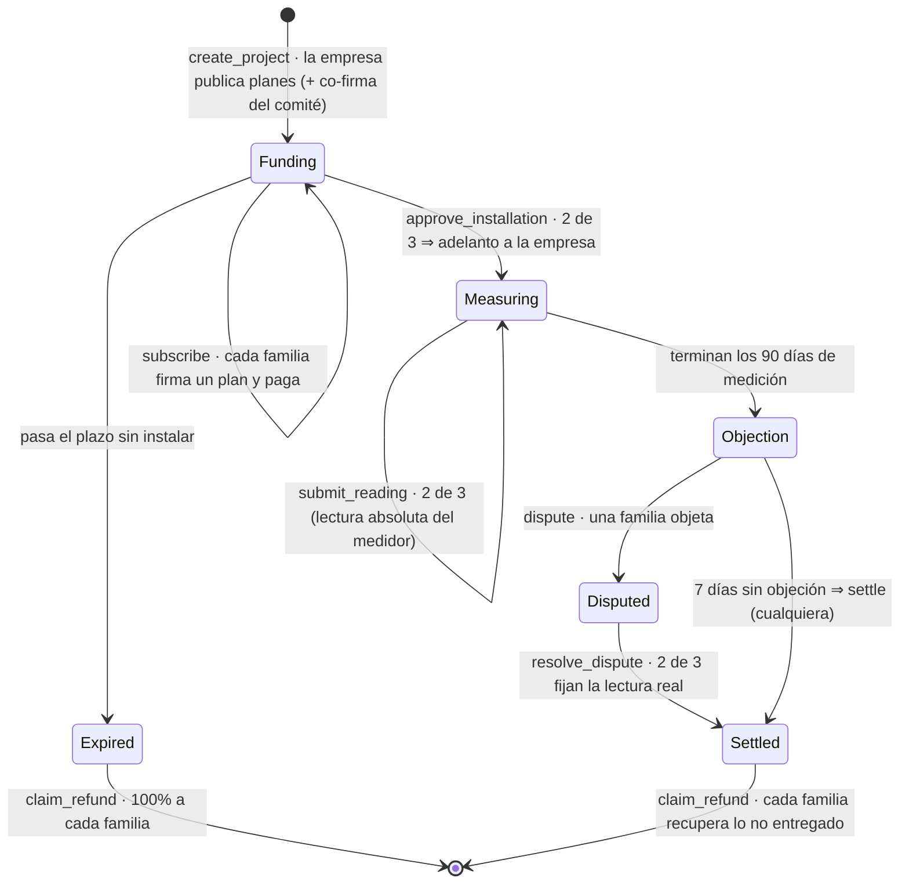

<div align="center">

# ☀️ Sol Comunitario

### Pagás por la luz que llega, no por la que te prometen.

Energía solar por suscripción para comunidades de Costa Rica.<br>
La empresa cobra **solo por los kWh que entrega** y los **vecinos verifican** cada lectura.<br>
Todo garantizado por un contrato inteligente en **Stellar (Soroban)**.


**[🌞 Ver la demo](https://relichtyy.github.io/sol-comunitario/)** ·
**[⛓️ Contrato en vivo](https://stellar.expert/explorer/testnet/contract/CCYWNAGKTLO7Y5M57EYGUJK35AVWPCVBMSX4GAEOEFFO66QILGISZKNM)** ·
**[📖 Cómo usarlo](#-cómo-usarlo)** ·
**[🚀 Correrlo](#-correrlo-en-tu-máquina)**

</div>

---

## ⚡ En 30 segundos

| | |
|---|---|
| **El problema** | Las familias pagan los paneles solares **por adelantado** y tienen que **confiar** en que la energía prometida va a llegar. |
| **La solución** | La plata queda en un **escrow** en Stellar. La empresa cobra en proporción a los **kWh realmente entregados**, medidos y firmados por un **comité de vecinos 2 de 3**. Lo que no se entregó **vuelve a cada familia**. |
| **La prueba** | Contrato **desplegado en testnet** con datos reales, **27 pruebas** en verde y una **página que lee el contrato en vivo**. |

> Reto individual de la semana 2 del **Pura Vida Bootcamp** (Oppia Climb · Stellar · BAF Network).

---

## 🏡 El problema

**Sol Comunitario S.A.** llega a Santa Teresa con tres planes de energía solar: *Básico* (1 panel), *Familiar* (2) y *Comercio* (4). Le muestra a cada familia **cuánto ahorraría** en su recibo de luz. Doña Ana (soda), Beto (pulpería) y la familia Mora quieren firmar. Pero:

- 💸 **Pagan antes de ver un solo kWh.** Si los paneles rinden la mitad, la plata ya se fue.
- 🤷 **¿Quién mide?** Si la empresa reporta su propia energía, ¿quién le cree?
- 🧾 **¿Y si nunca instalan?** Recuperar la plata es un pleito.

**¿Por qué este problema?** La generación solar distribuida está creciendo en Costa Rica, pero contratarla sigue siendo un acto de fe. Es un problema pequeño y concreto: una empresa, unos planes, unas familias y un comité de vecinos. Y es justo el tipo de confianza que un contrato inteligente resuelve mejor que un papel.

---

## ✅ La solución

| Hoy (sin contrato) | Con Sol Comunitario |
|---|---|
| Se paga todo por adelantado | La plata queda bloqueada en un **escrow** que nadie controla |
| La empresa dice cuánto generó | **2 de 3 vecinos** firman cada lectura del medidor |
| Si rinde menos, se pierde la diferencia | La empresa cobra **proporcional a los kWh**; el resto **vuelve a cada familia** |
| Si nunca instalan, hay que reclamar | Pasado el plazo, **100% de vuelta** automáticamente |
| Nadie puede revisar nada | Todo queda **público y verificable** en Stellar |

### Quién hace qué

| Actor | Rol |
|---|---|
| 🏢 **Sol Comunitario S.A.** | Publica los planes, instala y cobra por energía entregada. |
| 🏡 **Familias** | Eligen un plan, firman y pagan. Reciben su parte de la energía y del ahorro. |
| 👥 **Comité de vecinos** (ADI/ASADA, 2 de 3) | Confirma la instalación y firma las lecturas. La empresa **no** reporta su propia energía. |

---

## ⚙️ Cómo funciona



### Las cuentas, en claro

```
promesa del proyecto  = suma de los kWh de los planes firmados
ganado por la empresa = total × min(generado, prometido) / prometido
pago final            = max(ganado − adelanto, 0)
energía de la familia = generado × (kWh de su plan / promesa)
reembolso             = lo que pagó × (total − pagado a la empresa) / total
ahorro estimado       = kWh × tarifa eléctrica        ← off-chain
```

**Ejemplo:** Ana firma *Familiar* (500 kWh), Beto *Comercio* (1 000 kWh) y los Mora *Familiar* (500 kWh). La promesa es 2 000 kWh y los paneles generan 1 600 kWh (80%):

| | Recibe | De vuelta |
|---|---|---|
| Empresa | 80% de lo firmado | — |
| Doña Ana | 400 kWh | 20% de lo que pagó |
| Beto | 800 kWh | 20% de lo que pagó |
| Familia Mora | 400 kWh | 20% de lo que pagó |

### 🛡️ Protecciones

| Riesgo | Cómo lo evita el contrato |
|---|---|
| Una persona infla las lecturas | Toda lectura necesita **2 de 3 firmas** del comité |
| Contar un mes dos veces | Se firma la **lectura absoluta** del medidor, que solo puede subir (`MeterNotIncreasing`) |
| Dos miembros se ponen de acuerdo con la empresa | **7 días de objeción**: cualquier familia congela el pago (`dispute`) hasta que se firme la lectura real |
| Nadie liquida y la plata queda trabada | `settle` lo puede llamar **cualquiera** |
| La empresa nunca instala | Plazo vencido ⇒ **100% de vuelta** |
| Un miembro pierde su llave | `rotate_member`: la llave nueva hereda el rol (2 de 3) |
| Cobros de más | Adelanto ≤ 50% y pago total ≤ 100%, aunque se genere de más |
| Reclamar dos veces | La suscripción se borra antes de transferir el reembolso |

---

## 🔎 Pruébalo en 2 minutos

1. **[Abrí la demo](https://relichtyy.github.io/sol-comunitario/)**. El simulador guiado de 6 pasos usa las mismas reglas del contrato. Probá los escenarios *Rinde 80%*, *Rinde 15%*, *Lecturas infladas* (el comité hace trampa y Doña Ana objeta) y *Nunca se instala*.
2. **Bajá a "El contrato real, en vivo".** Esa sección lee el contrato desplegado en testnet: estado, XLM bloqueados, kWh medidos, el comité con sus roles y los planes.
3. **Verificalo vos mismo** en [stellar.expert](https://stellar.expert/explorer/testnet/contract/CCYWNAGKTLO7Y5M57EYGUJK35AVWPCVBMSX4GAEOEFFO66QILGISZKNM) o desde la terminal:

```bash
stellar contract invoke --id CCYWNAGKTLO7Y5M57EYGUJK35AVWPCVBMSX4GAEOEFFO66QILGISZKNM \
  --source <cualquier-identidad> --network testnet --send=no -- get_project --id 0
```

> **Demo cargada en testnet:** comité de 3, los 3 planes, dos familias suscritas, instalación confirmada 2 de 3 y la primera lectura del medidor (180 de 750 kWh). La medición dura 90 días reales.

---

## 📖 Cómo usarlo

Guía por rol. Los ejemplos usan el [Stellar CLI](https://developers.stellar.org/docs/tools/cli) en testnet. Para no repetir, definí antes:

```bash
export C=CCYWNAGKTLO7Y5M57EYGUJK35AVWPCVBMSX4GAEOEFFO66QILGISZKNM   # o tu propio contrato
export NET="--network testnet"
```

> Las funciones que piden **dos firmas a la vez** (`initialize`: todo el comité; `create_project`: empresa + un miembro) se hacen con [`scripts/demo-testnet.mjs`](scripts/demo-testnet.mjs), que junta las firmas con `authorizeEntry`. Todas las demás se pueden hacer con el CLI, una persona a la vez.

### 🏢 Si sos la empresa

1. **Publicá tus planes** junto con un miembro del comité (`create_project`, firma doble, vía script). Cada plan es `{name, panels, price, kwh}`, donde `kwh` es la energía que prometés entregar en la ventana de medición.
2. **Instalá los paneles** antes del plazo (`install_days`). Cuando 2 de 3 del comité lo confirmen, recibís el **adelanto** automáticamente.
3. **Al terminar la medición y la objeción**, cualquiera llama a `settle` y recibís el pago por los kWh entregados:

```bash
stellar contract invoke --id $C --source sc-solartico $NET -- settle --id 0
```

### 🏡 Si sos una familia

```bash
# 1. Ver los planes
stellar contract invoke --id $C --source sc-ana $NET --send=no -- get_plans --id 0

# 2. Firmar un plan (0 = Básico, 1 = Familiar, 2 = Comercio). Paga el precio al escrow.
stellar contract invoke --id $C --source sc-ana $NET -- subscribe --neighbor sc-ana --id 0 --plan 1

# 3. Ver cuánta energía te toca
stellar contract invoke --id $C --source sc-ana $NET --send=no -- get_share --id 0 --neighbor sc-ana

# 4. Si una lectura te parece inflada, objetá en los 7 días después de la medición
stellar contract invoke --id $C --source sc-ana $NET -- dispute --neighbor sc-ana --id 0

# 5. Al final (o si nunca instalaron), reclamá lo que no se entregó
stellar contract invoke --id $C --source sc-ana $NET -- claim_refund --neighbor sc-ana --id 0
```

### 👥 Si sos del comité

Cada acción la firman **dos miembros por separado con el mismo valor**. La primera firma devuelve `false` y la segunda (la mayoría) devuelve `true` y ejecuta la acción.

```bash
# Confirmar la instalación con la lectura inicial del medidor
stellar contract invoke --id $C --source sc-marta $NET -- approve_installation --member sc-marta --id 0 --meter_start 5000
stellar contract invoke --id $C --source sc-luis  $NET -- approve_installation --member sc-luis  --id 0 --meter_start 5000

# Cada mes: firmar lo que MARCA el medidor (siempre sube)
stellar contract invoke --id $C --source sc-marta $NET -- submit_reading --member sc-marta --id 0 --meter 5400
stellar contract invoke --id $C --source sc-luis  $NET -- submit_reading --member sc-luis  --id 0 --meter 5400

# Si una familia objetó: firmar la lectura real
stellar contract invoke --id $C --source sc-marta $NET -- resolve_dispute --member sc-marta --id 0 --meter 5320

# Si alguien perdió el celular: rotar su llave (lo firman los otros dos)
stellar contract invoke --id $C --source sc-marta $NET -- rotate_member --member sc-marta --old <G_VIEJA> --new <G_NUEVA>
```

### 🌐 Si solo querés mirar

- **La página:** https://relichtyy.github.io/sol-comunitario/. Tiene un simulador y la lectura en vivo.
- **Consultas sin firmar** (`--send=no`): `get_project`, `get_plans`, `get_config`, `get_share`, `is_member`, `performance_bps`.

---

## 📜 Funciones del contrato

| Función | Quién firma | Qué hace |
|---|---|---|
| `initialize(committee, threshold, token)` | Todo el comité | Credenciales (cuenta + rol), firmas necesarias y token (XLM, USDC…). |
| `create_project(installer, member, name, plans, advance_bps, install_days, measure_days)` | Empresa + 1 miembro | Publica de 1 a 5 planes `{name, panels, price, kwh}`. |
| `subscribe(neighbor, id, plan)` | Familia | Firma un plan y paga; la promesa crece con sus kWh. |
| `approve_installation(member, id, meter_start)` | Comité | Con 2 de 3: paga el adelanto y empieza a medir. |
| `submit_reading(member, id, meter)` | Comité | Con 2 de 3: registra la lectura absoluta. |
| `dispute(neighbor, id)` | Familia | Congela el proyecto durante la objeción. |
| `resolve_dispute(member, id, meter)` | Comité | Con 2 de 3: corrige la lectura y liquida. |
| `settle(id)` | Cualquiera | Paga a la empresa lo ganado. |
| `claim_refund(neighbor, id)` | Familia | Recupera lo no entregado (o el 100%). |
| `rotate_member` / `revoke_member` | Comité | Cambia la llave de un miembro o lo saca (2 de 3). |
| `get_project`, `get_plans`, `get_share`, `get_config`, `is_member`, `performance_bps`… | — | Consultas. `get_share` dice cuántos kWh le tocan a cada familia. |

---

## 🪪 Identidad y estándares

### Qué va on-chain y qué no

> **Regla:** en la cadena solo va lo que el contrato necesita para decidir quién puede mover la plata.

| ⛓️ On-chain | 📄 Off-chain |
|---|---|
| Cuenta G/C, rol y vigencia de cada miembro del comité | Su DID `did:pkh:stellar:testnet:G…`, que **se calcula** a partir de la cuenta |
| Planes y qué plan firmó cada familia | Nombres, cédulas y teléfonos. **Nunca on-chain** (Ley 8968 de protección de datos) |
| Pagos, firmas, lecturas, disputas y reembolsos | Tarifa eléctrica y **ahorro estimado** en colones |
| Rotación y revocación de miembros | `stellar.toml` de la ADI (SEP-1), fotos del medidor |
| Eventos de auditoría | Login (SEP-10/45), QR para firmar (SEP-7), la página web |

**¿Por qué "estilo DID"?** Separa **quién sos** (identidad y rol) de **con qué llave firmás**. Si Luis pierde el celular, Marta y Sofía firman `rotate_member` y su llave nueva hereda el rol "Fontanero ASADA".

### Cuentas G y C

`Address` y `require_auth()` aceptan **cuentas clásicas `G…`** (Freighter, Lobstr) y **contratos `C…`** (smart wallets con passkey: huella o Face ID). Una familia puede firmar con cualquiera de las dos sin cambiar el contrato.

### SEPs

| SEP | Estado en el proyecto |
|---|---|
| **SEP-41** · Token Interface | ✅ Pagos con `token::Client`: XLM, USDC o cualquier token SEP-41 |
| **SEP-46** · Contract Meta | ✅ `contractmeta!`: nombre, versión, descripción y repo en el WASM |
| **SEP-48** · Interface Spec | ✅ Generada por el SDK (bindings y exploradores) |
| SEP-1 · `stellar.toml` | La ADI publica sus cuentas en su dominio |
| SEP-10 / SEP-45 · Web Auth | Login para un frontend real (cuentas G / C) |
| SEP-7 · URI scheme | QR en el salón comunal para firmar desde el celular |
| SEP-53 · Sign messages | Siguiente paso: que el medidor firme sus lecturas |

### Equivalencia con Trustless Work

| Trustless Work | Sol Comunitario |
|---|---|
| Service provider / receiver | La empresa |
| Approver + release signer | Comité 2 de 3 |
| Dispute resolver | Comité 2 de 3 (`resolve_dispute`) |
| Milestones | Instalación → lecturas mensuales → liquidación |

---

## 🧪 Calidad: 27 pruebas (TDD)

Las pruebas viven en [`contracts/sol-comunitario/src/test.rs`](contracts/sol-comunitario/src/test.rs) y se escribieron **antes** del código.

| Grupo | Qué demuestran |
|---|---|
| **Camino feliz** | Planes, firmas, adelanto, 3 lecturas, energía por familia (400/200 kWh), liquidación y reembolsos. |
| **Planes** | La promesa crece con cada plan; no se firma dos veces ni un plan inexistente. |
| **Comité 2 de 3** | Una firma no basta, nadie firma dos veces, los extraños no firman, las lecturas en desacuerdo no cuentan, el medidor no retrocede. |
| **Pago por resultado** | Tope del 100%, bajo rendimiento (la empresa solo se queda el adelanto) y reembolso total si no se instala. |
| **Tiempos y estados** | No se liquida antes de tiempo, no se mide después, no hay doble cobro. |
| **Validaciones** | Planes inválidos, adelanto > 50%, comité mal formado, firmas requeridas, redondeo seguro. |
| **Objeción** | Una lectura inflada (1 000 kWh) se corrige a la real (600) antes de pagar. |
| **Identidad** | Credenciales con rol, rotación de llave y revocación sin romper el umbral. |

```
test result: ok. 27 passed; 0 failed
```

---

## 🚀 Correrlo en tu máquina

**Requisitos:** [Rust](https://rustup.rs/), [Stellar CLI](https://developers.stellar.org/docs/tools/cli) y Node.js 20+ (solo para el script de demo).

```bash
# 1. Pruebas
cargo test

# 2. Compilar a WASM
rustup target add wasm32v1-none
stellar contract build

# 3. Identidades de demo con XLM de testnet
for k in sc-deployer sc-marta sc-luis sc-sofia sc-ana sc-beto sc-solartico; do
  stellar keys generate $k --network testnet --fund
done

# 4. Desplegar
stellar contract deploy --wasm target/wasm32v1-none/release/sol_comunitario.wasm \
  --source sc-deployer --network testnet

# 5. Cargar la demo (firmas multi-parte con authorizeEntry)
cd scripts && npm install
node demo-testnet.mjs <CONTRACT_ID>
```

> 💡 **¿Windows sin Visual Studio C++?** Usá el toolchain GNU, que trae su propio linker: `cargo +stable-x86_64-pc-windows-gnu test`.
>
> 🔐 El script lee las llaves del Stellar CLI local (`stellar keys show`) y **nunca** las guarda en el repo.

---

## 🗂️ Estructura del repo

```
sol-comunitario/
├── contracts/sol-comunitario/
│   └── src/
│       ├── lib.rs        # el contrato Soroban
│       └── test.rs       # 27 pruebas
├── docs/index.html       # página + simulador + lectura en vivo (GitHub Pages)
├── scripts/
│   └── demo-testnet.mjs  # carga la demo en testnet con firmas de varias personas
└── Cargo.toml
```

---

## 🛣️ Qué sigue

- [ ] Que el **medidor firme sus propias lecturas** (SEP-53) y el comité solo co-firme
- [ ] Pagos en **USDC** o una stablecoin en colones
- [ ] Firmar desde el navegador con **Freighter** (y passkeys con SEP-45)
- [ ] Fondo de mantenimiento opcional para limpiar los paneles

---

<div align="center">

Hecho con ☀️ en Costa Rica por **Rihito**<br>
*Pura Vida Bootcamp · Semana 2 de 6 · 3 000 m*

</div>
